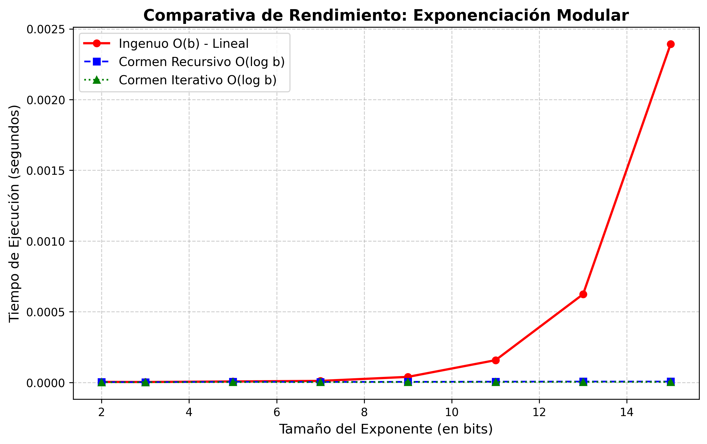

# Exponenciación modular: ingenuo vs. cuadrados repetidos

Implementación y comparación experimental de tres formas de calcular `a^b mod n`, basada en la sección 31.6 de *Introduction to Algorithms* (Cormen). Proyecto final de **Algoritmos y Complejidad** (Universidad del Norte, 2026).

**Autor:** Victor Mendoza

## Qué hace

Implementa tres algoritmos y mide cuánto tarda cada uno a medida que crece el exponente:

| Algoritmo | Tiempo | Espacio |
|---|---|---|
| Ingenuo (multiplica `b` veces) | O(b) | O(1) |
| Cuadrados repetidos, recursivo | O(log b) | O(log b) |
| Cuadrados repetidos, iterativo | O(log b) | O(1) |

Este cálculo es la base de RSA, Diffie-Hellman y el test de primalidad de Miller-Rabin.

## Resultados

Con exponentes de 2 a 15 bits, el método ingenuo crece exponencialmente con el número de bits, mientras que los dos métodos de Cormen se mantienen casi constantes. El iterativo es el más rápido.



Los tiempos exactos están en `resultados_experimento.csv`.

## Cómo ejecutarlo

```bash
pip install -r requirements.txt
python modular_math.py
```

El programa:

1. Verifica el ejemplo del libro (potencias de 3 módulo 7).
2. Corre el experimento y comprueba que los tres algoritmos den el mismo resultado.
3. Guarda los tiempos en `resultados_experimento.csv` y la gráfica en `grafica_rendimiento.png`.

## Archivos

- `modular_math.py`: algoritmos y experimento.
- `resultados_experimento.csv`: tiempos medidos.
- `grafica_rendimiento.png`: gráfica comparativa.
- `docs/informe.pdf`: informe con la teoría (teoremas de Euler y Fermat), el análisis de complejidad y las conclusiones.
